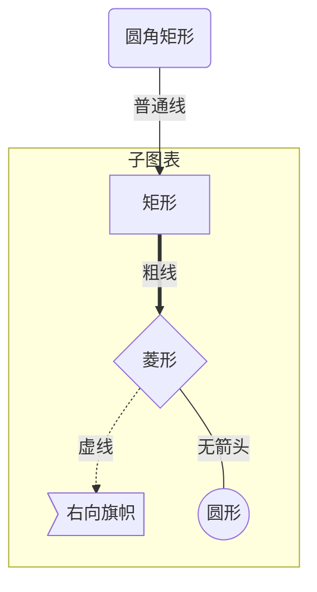

# Markdown 语法

## 1 基本语法

- [Markdown 语法](#markdown-语法)
  - [1 基本语法](#1-基本语法)
    - [1.1 标题](#11-标题)
    - [1.2 段落](#12-段落)
    - [1.3 换行](#13-换行)
    - [1.4 强调](#14-强调)
    - [1.5 引用](#15-引用)
    - [1.6 列表](#16-列表)
    - [1.7 代码](#17-代码)
    - [1.8 分割线](#18-分割线)
    - [1.9 链接](#19-链接)
    - [1.10 图片](#110-图片)
    - [1.11 转义字符](#111-转义字符)
    - [1.12 内嵌 HTML 标签](#112-内嵌-html-标签)
  - [2 扩展语法](#2-扩展语法)
    - [2.1 表格](#21-表格)
    - [2.2 脚注](#22-脚注)
    - [2.3 标题编号](#23-标题编号)
    - [2.4 todo list](#24-todo-list)
  - [3 其他](#3-其他)
    - [3.1 mermaid 流程图](#31-mermaid-流程图)
    - [3.2 公式](#32-公式)

### 1.1 标题

```markdown
# 一级标题
## 二级标题
### 三级标题
#### 四级标题
...
```

### 1.2 段落

空白行将一行或多行文本进行分隔。

```markdown
这是第一段。

这是第二段。
```

这是第一段。

这是第二段。

### 1.3 换行

```markdown
第一行，</br>
第二行

第一行，
仍是第一行。
```
第一行，</br>
第二行

第一行，
仍是第一行。

### 1.4 强调

**1.4.1 粗体**

```markdown
**这是粗体**

*这是斜体*

~~这是删除线~~
```
**这是粗体**

*这是斜体*

~~这是删除线~~

### 1.5 引用

```markdown
> 这是引用
>
>> 这是引用中的引用。
>
> 引用。
```

> 这是引用
>
>> 这是引用中的引用。
>
> 引用。

### 1.6 列表

**1.6.1 有序列表**

```markdown
1. item1
2. item2
3. item3

- item1
- item2
- item3
```
1. item1
2. item2
3. item3

- item1
- item2
- item3

### 1.7 代码

```markdown
行内代码：`if a == b` 。

转义反引号：

``Use `code` in your Markdown file.``

围栏代码块：

\```c
#include <stdio.h>

int main(int argc, const char *argv[]) {
    printf("Hello,world!");

    return 0;
}

\```


```

`if a == b`

``Use `code` in your Markdown file.``

```c
#include <stdio.h>

int main(int argc, const char *argv[]) {
    printf("Hello,world!");

    return 0;
}
```

### 1.8 分割线

```markdown
这是分割线：

---

为了兼容性，请在分隔线的前后均添加空白行。
```

这是分割线：

---

为了兼容性，请在分隔线的前后均添加空白行。

### 1.9 链接

```markdown
[Google](https://www.google.com)
给链接增加 title：
[Google](https://www.google.com "google !")
引用类型链接：
[Google][1]

[1]: https://www.google.com
```
[Google](https://www.google.com)

[Google](https://www.google.com "google !")

[Google][1]

### 1.10 图片

```markdown

给图片添加链接：
[](https://markdown.com.cn)

```

### 1.11 转义字符

要显示原本用于格式化 `Markdown` 文档的字符，请在字符前面添加反斜杠字符 `\`。

### 1.12 内嵌 HTML 标签

对于 `Markdown` 涵盖范围之外的标签，都可以直接在文件里面用 `HTML` 本身。如需使用 `HTML`，不需要额外标注这是 `HTML` 或是 `Markdown`，只需 `HTML` 标签添加到 `Markdown` 文本中即可。

## 2 扩展语法

### 2.1 表格

要添加表，请使用三个或多个连字符（---）创建每列的标题，并使用管道（|）分隔每列。

```markdown
| 姓名 | 性别 | 学校 |
| --- | --- | --- |
| 张三 | 男 | 五道口职业技术学院 |
| 李红 | 女 | 北雷村职业技术学院 |

对齐：

| 姓名 | 性别 | 学校 |
| :---: | :--- | ---: |
| 张三 | 男 | 五道口职业技术学院 |
| 李红 | 女 | 北雷村职业技术学院 |

```
| 姓名 | 性别 | 学校 |
| --- | --- | --- |
| 张三 | 男 | 五道口职业技术学院 |
| 李红 | 女 | 北雷村职业技术学院 |

对齐：

| 姓名 | 性别 | 学校 |
| :---: | :--- | ---: |
| 张三 | 男 | 五道口职业技术学院 |
| 李红 | 女 | 北雷村职业技术学院 |

### 2.2 脚注

```markdown
什么是五道口职业技术学院[^1]？

北雷村职业技术学院[^2]在哪里？

[^1]: 清华大学
[^2]: 西安电子科技大学
```

什么是五道口职业技术学院[^1]？

北雷村职业技术学院[^2]在哪里？

### 2.3 标题编号

```markdown
在与标题相同的行上用大括号括起该自定义ID。
### 标题1 {#custom-id}
通过创建带有数字符号（#）和自定义标题ID的[标准链接]((/basic-syntax/links.html)，可以链接到文件中具有自定义ID的标题。
[标题1](#custom-id)
可用于创建目录：
- [1 基本语法](#1-基本语法)
  - [1.1 标题](#11-标题)
  - [1.2 段落](#12-段落)
  - [1.3 换行](#13-换行)
  - [1.4 强调](#14-强调)
  - [1.5 引用](#15-引用)
  - [1.6 列表](#16-列表)
  - [1.7 代码](#17-代码)
  - [1.8 分割线](#18-分割线)
  - [1.9 链接](#19-链接)
  - [1.10 图片](#110-图片)
  - [1.11 转义字符](#111-转义字符)
  - [1.12 内嵌 HTML 标签](#112-内嵌-html-标签)
- [2 扩展语法](#2-扩展语法)
  - [2.1 表格](#21-表格)
  - [2.2 脚注](#22-脚注)
  - [2.3 标题编号](#23-标题编号)
  - [2.4 todo list](#24-todo-list)
```

### 2.4 todo list

```markdown
  - [ ] todo1
  - [ ] todo2
  - [x] todo3
```

  - [ ] todo1
  - [ ] todo2
  - [x] todo3


## 3 其他

其他支持：katex、front matter。

详见：

katex: https://github.com/waylonflinn/markdown-it-katex#syntax

front matter: https://github.com/waylonflinn/markdown-it-katex#syntax

### 3.1 mermaid 流程图

**图表方向**

方向有：`TB`、`BT`、`RL`，`LR`。

**节点定义**

流程图中每个文本块，包括开始、结束、处理、判断等。`Mermaid` 中每个节点都有一个 `id`，以及节点中的文字。

| 表述 | 说明 |
| :--: | :--: |
| `id[文字]` | 矩形节点 |
| `id(文字)` | 圆角矩形节点 |
| `id((文字))` | 圆形节点 |
| `id>文字]` | 右向旗帜状节点 |
| `id{文字}` | 菱形节点 |

**节点间的连线**

| 表述 | 说明 |
| -- | -- |
| `>` | 添加尾部箭头 |
| `-` | 不添加尾部箭头 |
| `--` | 单线 |
| `--text--` | 单线上加文字 |
| `==` | 粗线 |
| `==text==` | 粗线上文字 |
| `-.text.-` | 虚线加文字 |


**子图表**

```
subgraph 子图标名称
  描述语句
end
```

例子：



### 3.2 公式

[Markdown公式、特殊字符、上下标、求和/积分、分式/根式、字体](https://blog.csdn.net/weixin_42546496/article/details/88115095)

[Markdown/LaTeX 数学公式和符号表](https://zhuanlan.zhihu.com/p/450465546)

[1]: https://www.google.com "google it!"
[^1]: 清华大学
[^2]: 西安电子科技大学